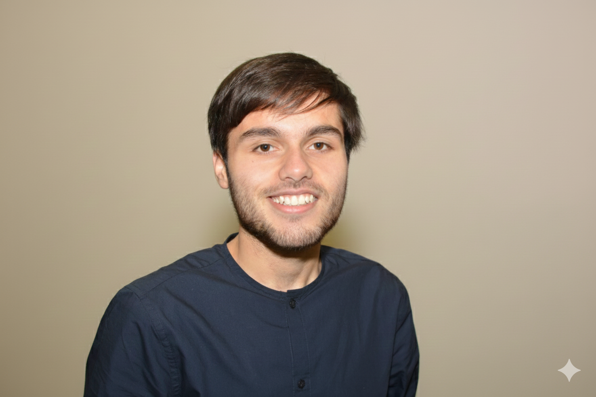

## Hey, I'm Furqan 👋

I'm a **Cloud & Software Engineer** based in the UK 🇬🇧. I build things for the web and cloud, and I'm passionate about creating software that solves real problems.

When I'm not coding, you'll find me traveling, exploring new cuisines, or writing about my experiences.

## 🔭 What I'm Working On

- Building scalable cloud infrastructure on AWS & Azure
- Exploring AI-assisted development workflows
- Writing about tech, career, and life on [my blog](https://furqanagwan.com/blog)

## ️ Technologies I Work With

## 📫 Let's Connect

I'm always open to interesting conversations and collaboration opportunities!

- 🌐 **Website:** [furqanagwan.com](https://furqanagwan.com)
- ✍️ **Blog:** [furqanagwan.com/blog](https://furqanagwan.com/blog)
- 💼 **LinkedIn:** [/in/furqanagwan](https://linkedin.com/in/furqanagwan)
- 𝕏 **X:** [@furqanagwan](https://x.com/furqanagwan)
- 📧 **Email:** Check my website for contact info

---

_"Documenting my journey in engineering & life."_

